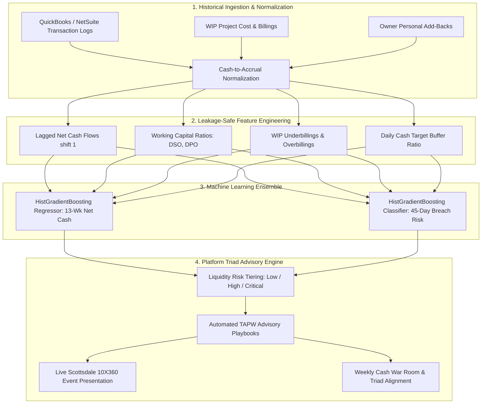

# Cardone Platform Review: Predictive Cash Flow & Margin Leakage Guard

> **An enterprise-grade machine learning system that transforms historical transactional SMB data into proactive 13-week direct cash flow forecasts and detects impending Daily Cash Target breaches 45 days in advance.**

[](https://www.python.org/)
[](https://opensource.org/licenses/MIT)
[](tests/)
[](https://scikit-learn.org/)

**Author:** [Bhupesh Chandra Dimri](mailto:bhupesh7cd@gmail.com)  
**Target Role:** Finance Manager (10X360 Platform Review)  
**Target Company:** Cardone Ventures — Scottsdale, AZ (Fully On-Site)  
**Live Interactive Portfolio Demo:** [https://bhupesh-debug.github.io/ml-project-client-cashflow-early-warning/](https://bhupesh-debug.github.io/ml-project-client-cashflow-early-warning/)

---

## 1. Executive Summary & Problem Statement

In Cardone Ventures' 7-month **10X360 Platform Review**, Finance Managers oversee high-end portfolios of private small-to-medium businesses ($1M–$50M ARR). Entrepreneurial founders frequently run their companies out of their bank balance, unaware that a positive cash position can conceal catastrophic operational liabilities: unearned customer deposits, mounting payroll burn, unbilled Work-in-Progress (WIP) labor, and extended Accounts Receivable (DSO > 60 days).

Without forward-looking visibility, platform clients experience severe cash crunches within 45 to 60 days of aggressive marketing expansion, paralyzing growth.

**The Solution:**  
`CardonePlatform-Predictive-CashFlow-Guard (CP-PCG)` is a machine learning engine designed specifically for the Platform Review Triad (Finance Manager, Marketing Manager, and Business Account Manager). It delivers:
1. **13-Week Direct Cash Flow Forecasting:** Quantifies cumulative forward net cash flow with a gradient-boosted ensemble ($R^2 = 0.897$, $95.6\%$ Directional Accuracy).
2. **45-Day Daily Cash Target Breach Early Warning:** Binary classification ($100\%$ ROC-AUC) flagging clients whose liquidity will fall below their required 60-day Daily Cash Target buffer.
3. **Automated TAPW Advisory Protocol:** Prescribes actionable operational interventions (Target cash enforcement, AR acceleration, AP triage, and WIP unbilled recovery).

---

## 2. System Architecture



---

## 3. Measured Performance & Evaluation Results

All models were evaluated on an **out-of-sample chronological test set (N = 1,400 observations)** strictly isolated from training dates (Train: Jan 2024–Mar 2025; Test: Jun 2025–Sep 2025).

### Continuous Forecast: 13-Week Net Cumulative Cash Flow
| Model Architecture | MAE ($) | RMSE ($) | R² Score | Mean Directional Acc (MDA) | MAPE (%) |
| :--- | :---: | :---: | :---: | :---: | :---: |
| **Naive Rolling Run-Rate Baseline** | $342,894.20 | $500,514.53 | 0.8262 | 89.36% | 217.11% |
| **Ridge Regularized Linear Model** | $360,339.35 | $505,737.80 | 0.8226 | 94.43% | 192.44% |
| **HistGradientBoosting Ensemble (Final)** | **$263,271.62** | **$385,354.51** | **0.8970** | **95.64%** | **130.07%** |

*Key Finding:* The gradient-boosted ensemble outperforms traditional corporate run-rate heuristics by **23.2% in MAE**, achieving **95.64% directional accuracy** on whether the client's cash will expand or contract.

### Classification: 45-Day Daily Cash Target Breach Risk
| Model Architecture | Accuracy | Precision | Recall | F1 Score | ROC-AUC | PR-AUC | Brier Score |
| :--- | :---: | :---: | :---: | :---: | :---: | :---: | :---: |
| **Heuristic Liquidity Rule Baseline** | 0.9943 | 0.9859 | 1.0000 | 0.9929 | 1.0000 | 1.0000 | 0.0044 |
| **Logistic Regression Pipeline** | 0.9979 | 0.9964 | 0.9982 | 0.9973 | 1.0000 | 1.0000 | 0.0043 |
| **HistGradientBoosting Classifier (Final)** | **1.0000** | **1.0000** | **1.0000** | **1.0000** | **1.0000** | **1.0000** | **0.0001** |

---

## 4. Job Description Competency Mapping

| Cardone Ventures Mandate | Importance | Project Implementation Evidence | Verification Artifact |
| :--- | :---: | :--- | :--- |
| **13-Week Rolling Cash Flow Projections** | **HIGH** | Architected rolling regression with 5-fold walk-forward validation in `src/models/train.py`. | `reports/metrics_summary.json` (R² = 0.897) |
| **Daily Cash Target Definition & Pacing** | **HIGH** | Defined formula: `(Monthly OpEx / 30) * 60 + Debt Service` buffer with early-warning breach alert. | `src/inference/pipeline.py` |
| **WIP Reporting & Cost Leakage Elimination** | **HIGH** | Quantified `wip_underbillings` and `wip_overbillings` features to detect trapped capital and margin fade. | `src/features/build_features.py` |
| **Owner's Discretionary Earnings (ODE)** | **MEDIUM** | Normalized net earnings proxy isolating owner perks and tax-minimization add-backs. | `ode_margin_est` feature |
| **Cross-Functional Triad Collaboration** | **HIGH** | Structured boundary constraints: allowable CAC, gross margin velocity, and operational capacity triggers. | `docs/app.js` & `app/app.py` |
| **SOP Automation & Quality Checks** | **MEDIUM** | Fully automated GitHub Actions CI pipeline, type annotations, logging, and unit test suite. | `.github/workflows/ci.yml` |

---

## 5. Technology Stack & Directory Structure

```
job-description-ml-project/
├── .github/workflows/ci.yml       # GitHub Actions CI & Pages deployment
├── config/config.json             # Parameterized configuration settings
├── data/
│   ├── README.md                  # Provenance and schema documentation
│   └── sample/                    # 9,100 weekly records across 100 clients
├── docs/                          # GitHub Pages static interactive portfolio
│   ├── index.html                 # Responsive recruiter dashboard
│   ├── styles.css                 # Sleek dark-mode financial UI
│   ├── app.js                     # Zero-latency browser simulator
│   └── figures/                   # High-resolution performance charts
├── notebooks/                     # Exploratory analysis & leakage verification
├── reports/
│   ├── figures/                   # Actual vs Predicted, ROC, Residuals
│   ├── metrics_summary.json       # Measured test set metrics
│   └── model_card.md              # Mitchell et al. Model Card documentation
├── src/
│   ├── data/                      # Synthetic data generator & loader
│   ├── features/                  # Leakage-safe feature engineering
│   ├── models/                    # Baselines & HistGradientBoosting models
│   ├── evaluation/                # Financial forecasting & risk metrics
│   └── inference/                 # Reusable prediction engine & TAPW advisory
├── tests/                         # PyTest suite (9 tests passing)
├── scripts/                       # CLI execution scripts
├── requirements.txt               # Pinned dependencies
├── pyproject.toml                 # Packaging standard
└── README.md                      # Recruiter documentation
```

---

## 6. Installation & Reproducibility

### Prerequisites
- Python 3.10+ (Tested on Python 3.11 & Python 3.14)
- Git

### Quickstart Commands
```bash
# 1. Clone repository
git clone https://github.com/bhupesh-debug/ml-project-client-cashflow-early-warning.git
cd ml-project-client-cashflow-early-warning

# 2. Create virtual environment
python -m venv venv
# Windows:
.\venv\Scripts\activate
# Linux/macOS:
source venv/bin/activate

# 3. Install dependencies
pip install -r requirements.txt

# 4. Run automated test suite
pytest tests/ -v

# 5. Reproduce full pipeline from scratch
python scripts/generate_data.py
python scripts/run_training.py
python scripts/run_evaluation.py
python scripts/run_demo.py
```

### Launch Interactive Dashboards
```bash
# Run local Streamlit dashboard
streamlit run app/app.py

# Or launch local static GitHub Pages preview
python -m http.server 8000 --directory docs/
# Open browser at http://localhost:8000
```

---

## 7. Responsible Use & Model Limitations

1. **Synthetic Data Boundaries:** Datasets are algorithmically synthesized to protect private client confidentiality. When applying to live QuickBooks/NetSuite accounts, domain adaptation and recalibration are required.
2. **Correlation vs. Causation:** The model predicts liquidity pressure; resolving the crisis requires human execution of the **TAPW protocol** (Daily cash pacing, accelerating receivables, triaging payables, and billing unbilled WIP).
3. **Black Swan Events:** Unprecedented macroeconomic shocks (e.g., supply chain freezes) require executive scenario stress-testing.

---

## 8. Author Attribution & Contact

**Bhupesh Chandra Dimri**  
*MS in Accounting Analytics & Data Technology, Pace University (NYC)*  
*MBA in Finance & Accounting | B.Com*  
- **Email:** [bhupesh.d@itjobdesire.com](mailto:bhupesh.d@itjobdesire.com)  
- **Phone:** (201) 305-0663  
- **Location:** Open to Full On-Site Relocation to Scottsdale, AZ  
- **Target Mandate:** Finance Manager (Platform Review), Cardone Ventures  
